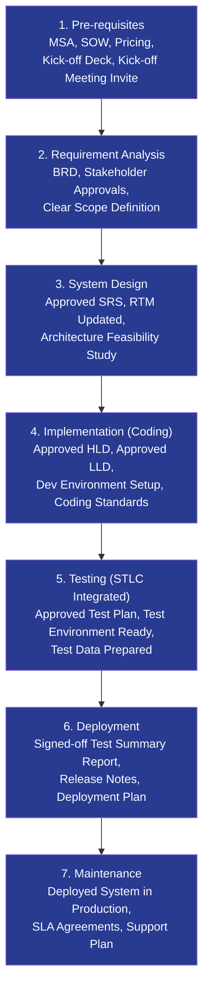
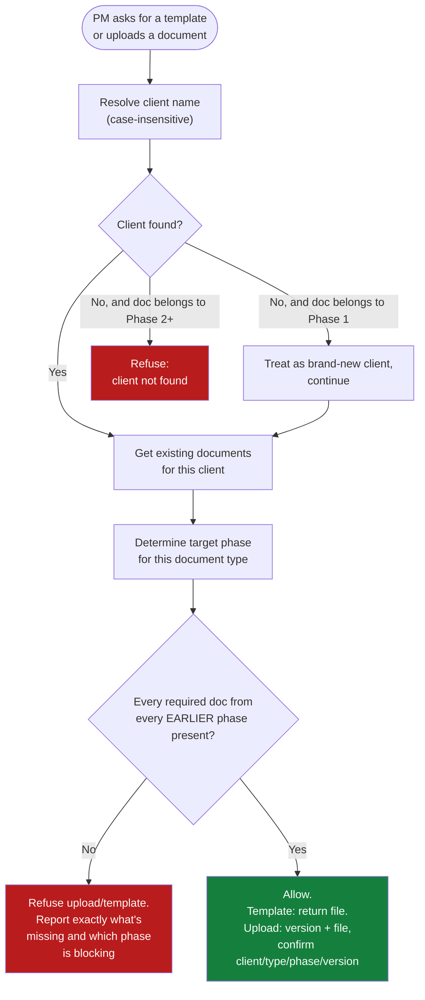

# AI Manager Agent

An internal Marlabs tool that helps a delivery manager (or PM) track client projects
through a fixed 7-phase document lifecycle — Pre-requisites, Requirement Analysis,
System Design, Implementation, Testing, Deployment, Maintenance — without anyone
accidentally skipping a required document or losing track of who's stuck where.

It's two things in one app:

1. **A conversational assistant** — a PM can ask in plain English for a template,
   check a client's status, or upload a completed document.
2. **A manager dashboard** — a portfolio-level view of every client at once, with
   clients flagged automatically if they've gone quiet mid-phase.

The core rule the whole system is built around: **a document belonging to phase N
can't be requested or filed until every required document from every earlier phase
already exists for that client.** This is enforced as a hard block in the backend,
not a suggestion — the conversational agent can't talk its way around it, because
the check happens in the API layer regardless of what the AI says.

For what's built vs. still pending and the full discovery docs, see
**[PROJECT_OVERVIEW.md](./PROJECT_OVERVIEW.md)**.

## Features

### Chatbot capabilities

The assistant (Groq-hosted Llama 3.3 70B) has four tools it can call — it can
only ever do what these tools allow, so it can't be talked into doing something
the system doesn't actually support:

1. **List phases** — all 7 phases and the exact documents required for each.
2. **Check a client's status** — which documents exist, which are missing, and
   which phase they're currently blocked on. Client name matching is
   case-insensitive ("Hillenbrand" and "hillenbrand" are never treated as two
   different clients).
3. **Request a master template** — hard-gated: refuses and explains exactly
   what's missing if any earlier phase is incomplete, rather than handing over
   a template out of order.
4. **Delete a client** — looks the client up and shows their info, but
   **never deletes anything itself**. It hands off to a confirm/cancel card in
   the UI; only a human clicking "Confirm & delete" actually removes anything
   (documents, database record, storage folder). The AI has no way of knowing
   whether the human confirmed, so it's never allowed to claim a deletion
   happened on its own.

On top of the tools themselves:

- **Attach-to-upload** — drop a completed file directly into the chat
  (paperclip button) instead of switching to the upload panel; shows an inline
  confirm-before-upload card that pre-fills client/doc-type guesses from the
  conversation, editable before anything is sent.
- **Clickable suggested prompts** on the empty chat screen — one click sends a
  real example question instead of typing from scratch.
- **Knows what it doesn't know** — for portfolio-wide questions it has no tool
  for (e.g. "how many clients do we have"), it points to the Dashboard tab
  instead of just declining, since that tab already answers it better than a
  bare number would.
- Every tool call renders inline in the chat as a visible activity line (⚙
  icon + summary) — gating decisions and lookups are never hidden inside the
  model's prose.

### Everything else

- **Document upload** — file a completed document for a client, either through
  the standalone upload panel or by attaching a file directly in the chat
  thread (with an inline confirm-before-upload card).
- **Hard-block phase-gating** — enforced in `app/services/document_service.py`,
  independent of the AI agent. Blocks both template requests and uploads if any
  earlier phase is incomplete, and reports exactly what's missing.
- **Manager dashboard** (`/api/clients/status`) — every client's phase
  progress, current blocking phase + missing documents, and a stale-client
  flag, with a copy-to-clipboard follow-up reminder generator.
- **Stale-client detection** — a client with no document uploaded in
  `stale_after_days` (default 3) is flagged automatically, no manual tracking
  needed.
- **Consistent file naming and filing** — `Marlabs_<DocType>_<ClientName>_
  <Timestamp>`, automatically filed under the right client/phase folder every
  time.
- **Case-insensitive client matching everywhere** — status, upload, template
  requests, and deletion all treat differently-cased lookups of the same
  client as one client, not two (fixed after a real bug where this wasn't
  true).
- **Marlabs branding** — logo, brand colors, dark navy hero banner, Poppins
  headings, matching Marlabs' existing internal tools.
- **One-command local dev** — `npm run dev` from `/frontend` starts backend and
  frontend together.

### What's working today

Backend and frontend fully built and integrated · Supabase Postgres (via REST
API, so it works even on networks that block direct DB ports) · phase-gating
logic fully tested · chat agent wired to Groq · document upload/download
tested end-to-end · dashboard + stale flagging + copy-reminder · client
deletion gated behind a mandatory human confirm/cancel click · 67 backend
tests passing, no known dependency CVEs.

### What's still pending

- **Real SharePoint integration** — templates/documents currently live in a
  local filesystem mock, not real SharePoint. The storage backend is already
  abstracted behind an interface (`backend/app/storage/base.py`), so swapping
  in a real `SharePointStorage` implementation later needs no changes to
  gating or service logic.
- **No authentication on any API endpoint** — fine for local dev, must be
  addressed before this is reachable outside a trusted network.
- **No upload file-size limit or file-type allow-list** yet.
- **No rate limiting** on `/api/chat` (calls a paid Groq API per request).

## How it works

The 7-phase lifecycle every client moves through:



The gating decision that runs on every template request and upload:



More flowcharts (client deletion, dashboard stale detection) and a table mapping
each step to its code live in **[docs/WORKFLOW.md](./docs/WORKFLOW.md)**.

> **Note:** this README and the rest of the repo document the coded app above.
> There is a second, separate system — a Microsoft Copilot Studio agent sitting
> on a real SharePoint library, with its own skills for upload/delete/restore/
> summarize/approval-lookup — that has no source code (it's configured entirely
> in Copilot Studio's UI). Its build log, known issues, and current Teams
> deployment blocker are written up in
> **[docs/copilot_studio_agent.md](./docs/copilot_studio_agent.md)**.

## Quick start

```bash
# Backend
cd backend
pip install -r requirements.txt
cp .env.example .env   # fill in GROQ_API_KEY, SUPABASE_URL, SUPABASE_KEY
alembic upgrade head
python -m app.db.seed
python -m app.db.seed_templates   # mock template library

# Frontend
cd ../frontend
npm install
```

Every time after that, from `/frontend`:

```bash
npm run dev
```

This starts both the backend (port 8000) and frontend (port 5173) together in one
terminal. Open `http://localhost:5173`.

See [`backend/README.md`](./backend/README.md) and
[`frontend/README.md`](./frontend/README.md) for setup details specific to each
side, [`docs/WORKFLOW.md`](./docs/WORKFLOW.md) for how a document moves through
the system (with flowcharts), and [`docs/`](./docs) for the original discovery
documentation and database structure.

## Tech stack

**Backend** — Python 3.11, FastAPI, [Groq](https://groq.com/) (Llama 3.3 70B) for
the chat agent, [Supabase](https://supabase.com/) (Postgres via REST API), pytest
(67 tests).

**Frontend** — React 19 + Vite, plain JS, hand-written CSS.

**Storage** — abstracted behind `StorageBackend`
(`backend/app/storage/base.py`), currently a local filesystem mock, designed to be
swapped for a SharePoint implementation later with no changes to gating or
service logic.
