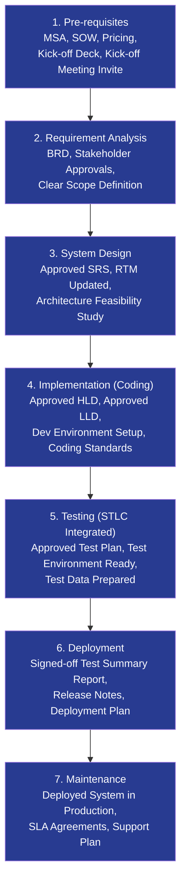
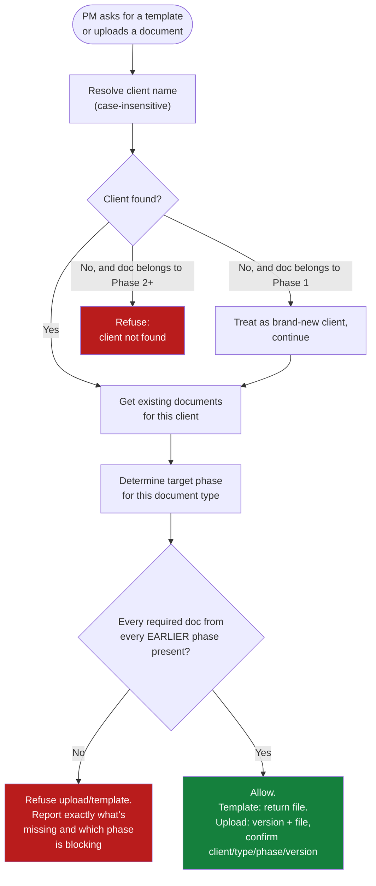
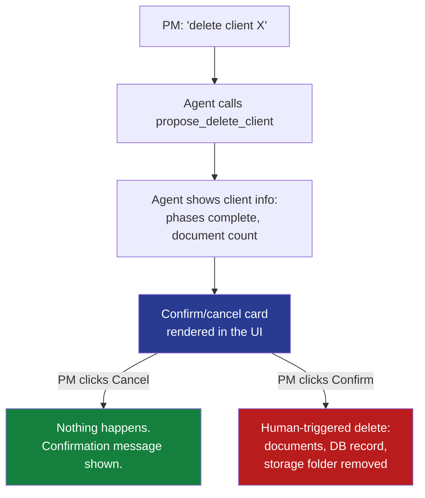
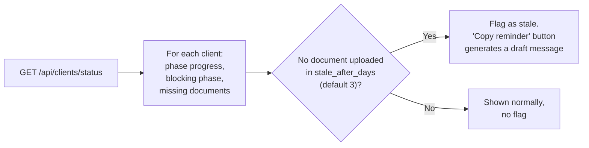

# Workflow

How a document moves through the system, and how the chat agent, the dashboard,
and the hard-block gating logic all fit together.

## 1. Client document lifecycle (the 7 phases)

Every client moves through the same fixed, ordered set of phases. A phase can't
be entered until every required document from every earlier phase already
exists for that client — enforced server-side in
`backend/app/services/document_service.py`, not just suggested by the chat agent.

## 2. Template request / document upload — the gating decision

This is the actual decision tree that runs every time someone (PM or chat agent)
asks for a template or tries to upload a document. The agent and the raw API hit
the exact same check, so the agent can't talk its way around a block.

## 3. Client deletion — human-in-the-loop, always

The AI can look a client up and summarize what deleting them would do, but it
can never perform the deletion itself. Only a human clicking "Confirm" in the
UI can make that true — the agent has no way to know whether that click happened.

## 4. Manager dashboard — stale detection

Read-only aggregation, no gating logic of its own — it just reports what the
gating/service layer already knows about every client at once.

## Where each piece lives

| Step | Code |
|---|---|
| Phase/document config (source of truth) | `config/sdlc_phase_config.json` |
| Hard-block gating | `backend/app/services/document_service.py` |
| Chat agent tool definitions | `backend/app/agent/tools.py` |
| Chat turn orchestration | `backend/app/agent/orchestrator.py` |
| Storage abstraction (swap-in SharePoint later) | `backend/app/storage/base.py` |
| Dashboard / stale flagging | `backend/app/services/dashboard_service.py` |
